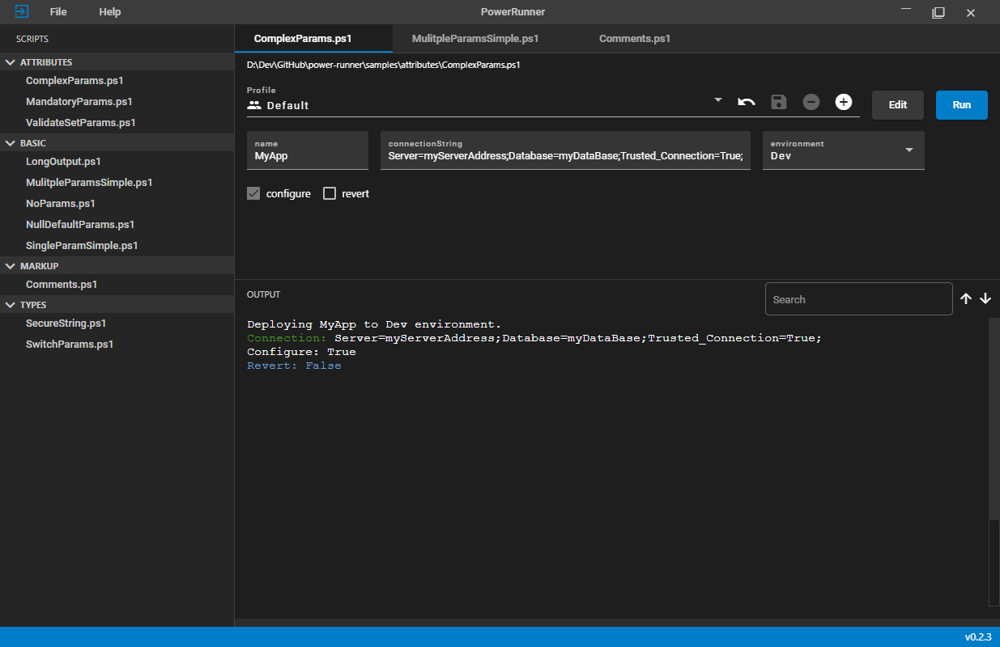

# PowerRunner

PowerShell Script Runner — a desktop application that loads PowerShell scripts from configurable paths, parses their command-line parameters, and presents them in a tabbed form with auto-generated inputs and a live output window.



## Example Script

```PowerShell
param (
  [string]$name = 'MyApp',
  [string]$connectionString = 'Server=myServerAddress;Database=myDataBase;Trusted_Connection=True;',
  [string][ValidateSet("Dev", "Test", "Stage", "Prod")]$environment = "Dev",
  [bool]$configure = $true,
  [switch]$revert = $false
)

Write-Host "Deploying $name to $environment environment."
Write-Host "Connection: $connectionString"
Write-Host "Configure: $configure"
Write-Host "Revert: $revert" -ForegroundColor Blue
```

## Features

- Auto-generated form inputs, dropdowns, and checkboxes from script parameters
- Script description and metadata display
- Tabbed interface for running multiple scripts simultaneously
- Hierarchical script browsing by directory structure
- Quick edit and run from the script tree
- Saved parameter profiles for sharing and reuse
- Copy command with parameters to clipboard
- Elevated (administrator) script execution
- External window execution
- One-click stop/start for running scripts
- Searchable and browsable console output
- Automatic self-updating

## Get Started

| Audience | Guide |
|---|---|
| **End users** | [User Guide](user-guide.md) — installation, setup, running scripts, profiles |
| **Developers** | [Developer Guide](developer-guide.md) — setup, build, test, release |
| **Architects** | [Architecture](architecture.md) — code structure, IPC bridge, data flow |

## Quick Links

- [GitHub Releases](https://github.com/greggbjensen/power-runner/releases/) — download the installer
- [Troubleshooting](troubleshooting.md) — common issues and fixes
